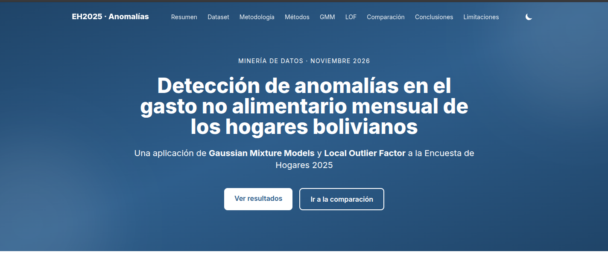
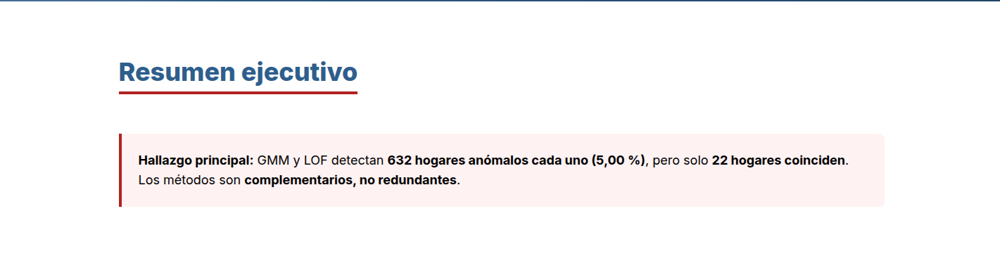
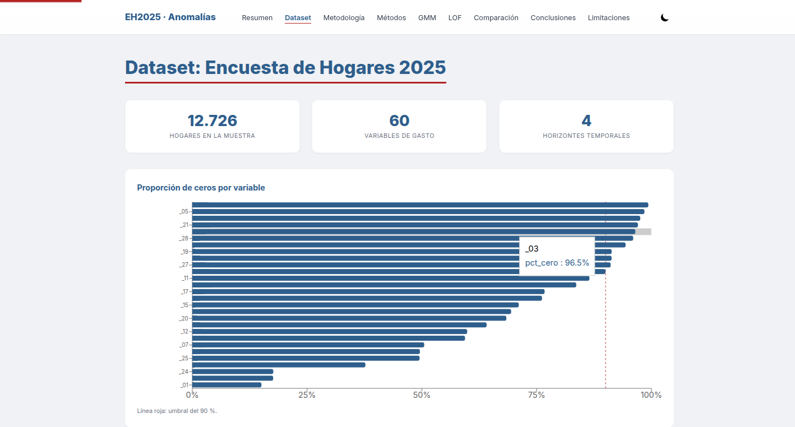
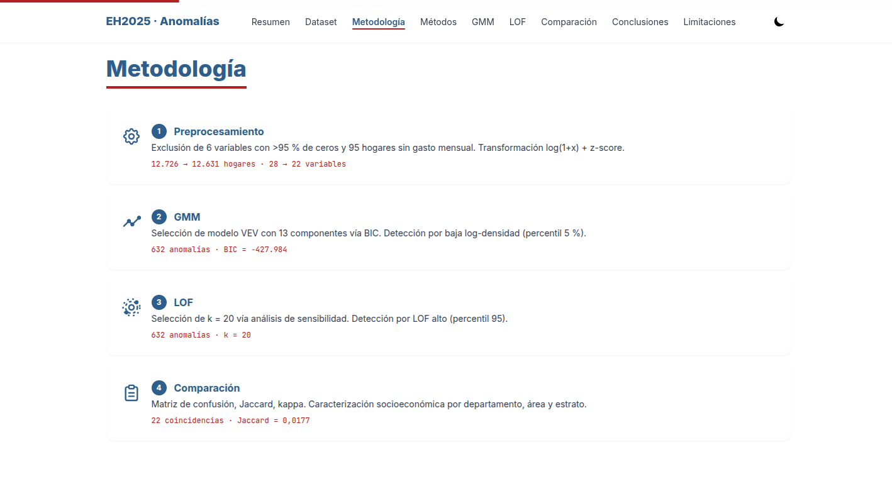
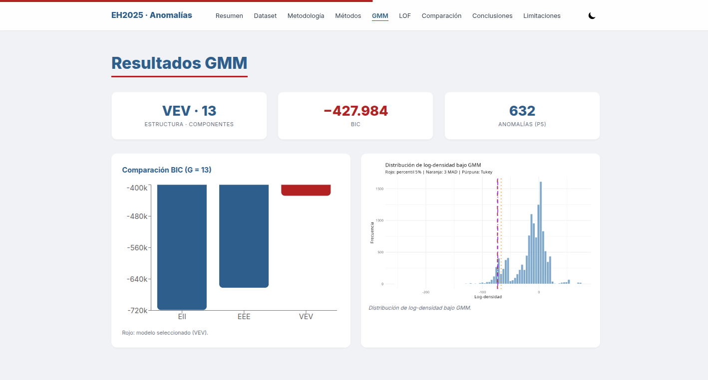
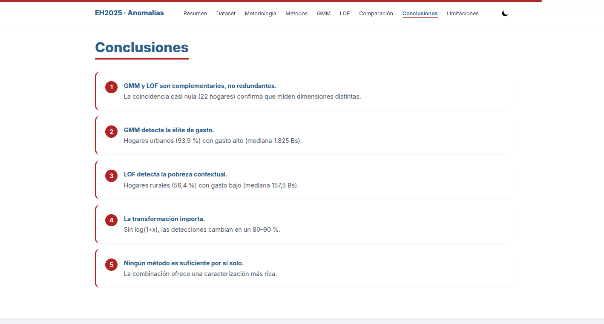

---
output:
  pdf_document:
    toc: false
    toc_depth: 3
    number_sections: true
    fig_caption: true
    latex_engine: xelatex
    keep_tex: true
lang: es
fontsize: 11pt
geometry: margin=2.5cm
linkcolor: blue
urlcolor: blue
header-includes:
  - \usepackage{amsmath,amssymb,booktabs,longtable,array,float}
  - \usepackage{caption,setspace,xurl,fvextra}
  - \captionsetup{font=small,labelfont=bf}
  - \onehalfspacing
  - \setlength{\emergencystretch}{3em}
  - \AtBeginDocument{\hypersetup{pdftitle={Detección de anomalías en los patrones de gasto no alimentario mensual de los hogares bolivianos mediante GMM y LOF},pdfauthor={Reyes Barja Carlos Eduardo}}}
---

```{r setup, include=FALSE}
knitr::opts_chunk$set(echo=FALSE, warning=FALSE, message=FALSE,
  fig.align="center", fig.pos="H", out.width="92%", dpi=150)
library(knitr); library(readr); library(dplyr); library(tidyr); library(ggplot2)
ruta_tablas <- "../output/tables"; ruta_figuras <- "../output/figures"
ruta_modelos <- "../output/models"; ruta_proc <- "../data/processed"
fmt_es <- function(x,d=0) formatC(x,format="f",digits=d,big.mark=".",decimal.mark=",")
resumen_uni <- read_csv(file.path(ruta_tablas,"fase3_resumen_univariado.csv"),show_col_types=FALSE)
gmm_det <- read_csv(file.path(ruta_tablas,"gmm_detecciones.csv"),show_col_types=FALSE)
lof_det <- read_csv(file.path(ruta_tablas,"lof_detecciones.csv"),show_col_types=FALSE)
metricas <- read_csv(file.path(ruta_tablas,"fase8_metricas_acuerdo.csv"),show_col_types=FALSE)
caract_cat <- read_csv(file.path(ruta_tablas,"fase8_caract_categoria.csv"),show_col_types=FALSE)
sens_umbral <- read_csv(file.path(ruta_tablas,"fase8_sensibilidad_umbrales.csv"),show_col_types=FALSE)
sens_log <- read_csv(file.path(ruta_tablas,"fase8_efecto_log1p.csv"),show_col_types=FALSE)
sens_k <- read_csv(file.path(ruta_tablas,"lof_sensibilidad_k.csv"),show_col_types=FALSE)
diag_trans <- read_csv(file.path(ruta_proc,"fase4_diagnostico.csv"),show_col_types=FALSE)
gmm_modelo <- readRDS(file.path(ruta_modelos,"gmm_final.rds"))
bic_largo <- as.data.frame(as.table(gmm_modelo$BIC)); names(bic_largo)<-c("G","modelo","BIC")
bic_largo <- bic_largo |> mutate(G=as.integer(as.character(G)),BIC=as.numeric(BIC)) |> filter(is.finite(BIC))
bic_top <- bic_largo |> arrange(desc(BIC)) |> slice_head(n=10)
n_muestra<-nrow(gmm_det); n_gmm<-sum(gmm_det$anomalo_p5); n_lof<-sum(lof_det$anomalo_p5)
n_ambos<-metricas$valor[metricas$metrica=="n_ambos"]
jaccard<-metricas$valor[metricas$metrica=="Jaccard"]
kappa<-metricas$valor[metricas$metrica=="Cohen_kappa"]
umbral_gmm<-as.numeric(quantile(gmm_det$logdens,.05)); umbral_lof<-as.numeric(quantile(lof_det$lof,.95))
```

\begin{titlepage}
\centering

{\Large\bfseries UNIVERSIDAD MAYOR DE SAN ANDRÉS\par}

\vspace{0.5cm}

\includegraphics[height=7cm]{assets/logo_umsa.png}

\vspace{0.6cm}

{\large\bfseries DATA MINING — DAT-253\par}

\vspace{0.7cm}

{\Large\bfseries DETECCIÓN DE ANOMALÍAS EN LOS PATRONES DE GASTO NO ALIMENTARIO MENSUAL DE LOS HOGARES BOLIVIANOS MEDIANTE GAUSSIAN MIXTURE MODELS Y LOCAL OUTLIER FACTOR\par}

\vspace{0.3cm}

{\large Una aplicación a la Encuesta de Hogares 2025\par}

\vfill

\begin{tabular}{@{}>{\bfseries}p{3.0cm}p{9.5cm}@{}}
Estudiante: & Univ. Reyes Barja Carlos Eduardo.\\[0.18cm]
Docente: & M.Sc. Menfy Morales Rios.\\[0.18cm]
Materia: & Data Mining.\\[0.18cm]
Sigla: & DAT-253.\\[0.18cm]
CI: & 9911763.\\[0.18cm]
Fecha: & 22 de noviembre de 2026.\\
\end{tabular}

\vfill

{\large\bfseries LA PAZ - BOLIVIA\par}

\end{titlepage}

\pagenumbering{roman}
\tableofcontents
\clearpage
\pagenumbering{arabic}
\setcounter{page}{1}

# Resumen

La Encuesta de Hogares 2025 (EH2025) del Instituto Nacional de Estadística de Bolivia contiene 12.726 hogares y 66 variables en su archivo de gastos no alimentarios. Este trabajo aplica y compara dos métodos no supervisados de detección de anomalías —_Gaussian Mixture Models_ (GMM) y _Local Outlier Factor_ (LOF)— sobre las 28 variables cuyo período de referencia es el último mes. Se excluyeron seis variables con más de 95 % de ceros y 95 hogares sin gasto en las 22 variables retenidas. La matriz final comprende `r fmt_es(n_muestra)` hogares y 22 variables transformadas mediante $\log(1+x)$ y estandarización $z$.

El GMM seleccionado por el criterio de información bayesiano fue VEV con 13 componentes (BIC = `r fmt_es(gmm_modelo$bic,1)`). Para LOF se eligió $k=20$, el primer valor evaluado sin puntuaciones infinitas y con variación reducida del percentil 95. Con umbrales percentilares simétricos, cada método clasificó `r fmt_es(n_gmm)` hogares (5,00 %) como anomalías. Solo `r fmt_es(n_ambos)` hogares fueron comunes: Jaccard = `r fmt_es(jaccard,4)` y $\kappa$ de Cohen = `r fmt_es(kappa,3)`. Los casos exclusivos de GMM presentaron mayor gasto mensual retenido (mediana: Bs 1.825,0) y fueron predominantemente urbanos (93,9 %); los exclusivos de LOF tuvieron menor gasto (mediana: Bs 157,5) y mayor presencia rural (56,4 %).

Los resultados apoyan una lectura complementaria de las puntuaciones globales y locales, pero no permiten identificar fraude, error de registro, pobreza ni riqueza. La cuota de 5 % fue impuesta por diseño y no estimada por los algoritmos. Además, el análisis no incorporó ponderadores ni variables de ingreso o composición del hogar. Las detecciones deben entenderse como prioridades para revisión, no como diagnósticos.

**Palabras clave:** detección de anomalías; GMM; Local Outlier Factor; gasto no alimentario; Encuesta de Hogares; Bolivia.

\newpage

# Introducción

Las encuestas de hogares permiten estudiar condiciones de vida, ingresos, empleo, educación, salud y consumo. Según el catálogo oficial, la EH2025 tiene cobertura nacional, urbana y rural, y emplea un diseño probabilístico, estratificado y bietápico. Su módulo de gastos no alimentarios registra 12.726 casos y 66 variables; la unidad de análisis es el hogar (Instituto Nacional de Estadística [INE], 2026a, 2026b).

Los datos de gasto combinan una gran cantidad de ceros legítimos con valores positivos de cola larga. Esto produce distribuciones dispersas, asimétricas y patrones repetidos. Una regla univariada puede señalar importes altos, pero no necesariamente identifica configuraciones multivariantes raras: dos hogares con el mismo gasto total pueden distribuirlo de manera distinta entre transporte, educación, telecomunicaciones y consumo fuera del hogar.

GMM estima una densidad global como mezcla de distribuciones gaussianas; una observación es más atípica cuanto menor es su densidad. LOF compara la densidad local con la de los vecinos; una observación recibe una puntuación alta si está relativamente aislada (Breunig et al., 2000; Scrucca et al., 2023). El objetivo no es decidir de antemano qué algoritmo es “mejor”, sino determinar si priorizan los mismos hogares, qué perfiles describen y cuán sensibles son a las decisiones analíticas.

# Justificación

La EH2025 representa la heterogeneidad de nueve departamentos y áreas urbanas y rurales. Priorizar patrones inusuales puede apoyar controles de calidad y exploración de segmentos minoritarios, siempre que “anómalo” se entienda como estadísticamente inusual bajo una representación y umbral concretos, no como irregular o fraudulento.

Metodológicamente, GMM y LOF responden a nociones distintas de rareza. Compararlos en una misma matriz y con una cuota percentilar común permite estudiar la diferencia entre sus ordenamientos. El proyecto conserva scripts por etapas, semillas, rutas relativas, tablas, figuras y modelos. Los recursos públicos son:

- Repositorio: \url{https://github.com/KaelAO123/deteccion-anomalias-gmm-lof}
- Sitio: \url{https://kaelao123.github.io/deteccion-anomalias-gmm-lof/}

# Objetivos

## Objetivo general

Aplicar y comparar GMM y LOF para identificar patrones atípicos en el gasto no alimentario mensual de los hogares bolivianos registrados en la EH2025, caracterizando las detecciones y evaluando su sensibilidad.

## Objetivos específicos

1. Explorar ceros, dispersión y asimetría de las variables mensuales.
2. Preparar una matriz mediante selección, $\log(1+x)$ y estandarización.
3. Seleccionar un GMM mediante BIC y calcular log-densidades.
4. Calcular LOF para distintos vecindarios y justificar $k$.
5. Comparar detecciones mediante intersección, Jaccard y $\kappa$.
6. Describir los grupos por gasto, área y departamento.
7. Evaluar sensibilidad a umbrales y transformación.
8. Documentar limitaciones y reproducibilidad.

# Conceptos clave

**Detección de anomalías.** Proceso de identificar observaciones que se apartan del comportamiento predominante. En este estudio, una anomalía es un patrón de gasto estadísticamente inusual; no implica fraude, error ni conducta indebida.

**Gaussian Mixture Model (GMM).** Modelo probabilístico que representa una población heterogénea como combinación de varias distribuciones normales multivariantes. Cada componente posee un peso, una media y una matriz de covarianza. En detección de anomalías, los hogares con menor densidad estimada bajo la mezcla se consideran más atípicos.

**Algoritmo Expectation--Maximization (EM).** Procedimiento iterativo utilizado para estimar los parámetros del GMM. El paso E calcula la probabilidad de pertenencia de cada hogar a cada componente; el paso M actualiza pesos, medias y covarianzas.

**Criterio de información bayesiano (BIC).** Medida que equilibra ajuste y complejidad del modelo. Penaliza el exceso de parámetros y permite comparar estructuras de covarianza y números de componentes. En `mclust`, se elige el BIC más alto.

**Local Outlier Factor (LOF).** Método no paramétrico que compara la densidad local de una observación con la densidad de sus vecinos. Un LOF cercano a 1 indica un entorno semejante; un valor elevado indica que el hogar está más aislado que sus vecinos y, por ello, puede ser localmente atípico.

**Número de vecinos ($k$).** Hiperparámetro de LOF que determina el tamaño del entorno local. Valores pequeños capturan rarezas muy próximas, pero son sensibles a duplicados y ruido; valores grandes suavizan la estructura local.

**Densidad global y densidad local.** GMM evalúa la probabilidad de un hogar respecto de la distribución completa; LOF evalúa su rareza respecto de un vecindario. Esta diferencia explica que ambos métodos puedan detectar conjuntos distintos.

**Transformación $\log(1+x)$.** Transformación que conserva los ceros y reduce la influencia de gastos extremadamente altos. Después se aplica estandarización $z$ para que todas las variables tengan una escala comparable.

**Índice de Jaccard y $\kappa$ de Cohen.** Jaccard mide la proporción de casos comunes respecto de la unión de dos listas de anomalías. $\kappa$ compara el acuerdo observado con el esperado por azar dadas las proporciones marginales.

# Marco teórico

## Detección no supervisada

Sea $\mathbf{x}_i\in\mathbb{R}^d$ un hogar. Un detector no supervisado asigna una puntuación $s(\mathbf{x}_i)$ sin etiqueta verdadera. La decisión binaria requiere un umbral $c$: el algoritmo ordena y el analista fija una regla. En este trabajo, 5 % es una cuota operativa, no una prevalencia estimada.

## Gaussian Mixture Model

Un GMM con $G$ componentes representa:

\[
p(\mathbf{x}_i\mid\Theta)=\sum_{g=1}^{G}\pi_g\phi_d(\mathbf{x}\_i\mid\boldsymbol\mu_g,\boldsymbol\Sigma_g),\qquad \sum_g\pi_g=1.
\]

La normal multivariante es:

\[
\phi_d(\mathbf{x}\mid\boldsymbol\mu,\boldsymbol\Sigma)=
\frac{\exp[-\tfrac12(\mathbf{x}-\boldsymbol\mu)^\top\boldsymbol\Sigma^{-1}(\mathbf{x}-\boldsymbol\mu)]}
{(2\pi)^{d/2}|\boldsymbol\Sigma|^{1/2}}.
\]

EM alterna responsabilidades

\[
\tau\_{ig}=\frac{\pi_g\phi_d(\mathbf{x}\_i\mid\boldsymbol\mu_g,\boldsymbol\Sigma_g)}
{\sum_h\pi_h\phi_d(\mathbf{x}\_i\mid\boldsymbol\mu_h,\boldsymbol\Sigma_h)}
\]

y actualización de parámetros. `mclust` parametriza covarianzas por volumen, forma y orientación; VEV significa volumen variable, forma igual y orientación variable (Scrucca et al., 2023). La selección usa

\[
\mathrm{BIC}=2\ell(\widehat\Theta)-m\log(n),
\]

y, bajo la convención de `mclust`, se prefiere el **BIC más alto** (Schwarz, 1978). Se consideran anómalas las log-densidades bajas.

## Local Outlier Factor

LOF (Breunig et al., 2000) define:

\[
\operatorname{reach\mbox{-}dist}\_k(p,o)=\max\{k\operatorname{-distance}(o),d(p,o)\},
\]

\[
\operatorname{lrd}_k(p)=\left(\frac{1}{|N_k(p)|}\sum_{o\in N_k(p)}\operatorname{reach\mbox{-}dist}\_k(p,o)\right)^{-1},
\]

\[
\operatorname{LOF}_k(p)=\frac{1}{|N_k(p)|}\sum_{o\in N_k(p)}\frac{\operatorname{lrd}\_k(o)}{\operatorname{lrd}\_k(p)}.
\]

LOF cercano a 1 indica densidad similar al vecindario; valores altos indican aislamiento relativo. Duplicados y vecindarios pequeños pueden producir distancias cero y puntuaciones infinitas (Hahsler et al., 2019).

## Coincidencia

Para detecciones $A$ y $B$, $J(A,B)=|A\cap B|/|A\cup B|$. Además, $\kappa=(p_o-p_e)/(1-p_e)$ corrige el acuerdo por el esperado según las proporciones marginales. Jaccard es preferible al acuerdo global cuando predomina la clase no detectada.

# Metodología

## Fuente y unidad de análisis

Se utilizó `EH2025_Gastos_No_Alimentarios.sav`, publicado por el INE. `folio` es único; las 28 variables mensuales no contienen faltantes ni negativos. `area`: 1 urbana, 2 rural; `depto`: códigos 1 a 9 (INE, 2026b).

## Selección y preprocesamiento

Se excluyeron seis variables con más de 95 % de ceros.

```{r tabla-excluidas, results='asis'}
excluidas <- resumen_uni |> filter(pct_cero>95) |> mutate(descripcion=recode(variable,
 s08b_10_22="Guarderías infantiles",s08b_10_05="CD, casetes y video",
 s08b_10_09="Servicio doméstico",s08b_10_21="Transferencias a otros hogares",
 s08b_10_03="Periódicos, libros y revistas",s08b_10_28="Telefonía fija"),
 `Ceros (%)`=fmt_es(pct_cero,2)) |> select(Variable=variable,Descripción=descripcion,`Ceros (%)`)
kable(excluidas,format="latex",booktabs=TRUE)
```

```{r figura-ceros, fig.cap='Proporción de ceros en las 28 variables mensuales. La figura usa 90 % como referencia exploratoria; la exclusión final usó más de 95 %.', out.width='78%'}
include_graphics(file.path(ruta_figuras,"fase3_pct_ceros.png"))
```

Después se excluyeron 95 hogares con suma cero en las 22 variables retenidas, se aplicó $\log(1+x)$ y se estandarizó cada columna. La asimetría transformada quedó entre `r fmt_es(min(diag_trans$asim_log1p),2)` y `r fmt_es(max(diag_trans$asim_log1p),2)`: la transformación mitiga, pero no elimina, la masa en cero.

```{r figura-log, fig.cap='Distribuciones originales y transformadas en cuatro variables representativas.'}
include_graphics(file.path(ruta_figuras,"fase3_hist_orig_vs_log.png"))
```

## Modelado y evaluación

Para GMM se evaluaron $G=1,\ldots,15$ y 14 estructuras de covarianza. De 210 celdas potenciales, 109 tuvieron BIC finito. El umbral fue el percentil 5 de log-densidad (`r fmt_es(umbral_gmm,4)`). Para LOF se evaluó $k\in\{5,10,15,20,30,50\}$; $k=20$ fue el primer valor sin puntuaciones infinitas y su percentil 95 cambió solo `r fmt_es(sens_k$delta_p95[sens_k$k==20],3)` % frente a $k=15$. El corte final fue `r fmt_es(umbral_lof,4)`.

La evaluación incluyó matriz 2x2, Jaccard, $\kappa$, sensibilidad a cuotas de 1 %, 5 % y 10 %, y comparación con una matriz sin $\log(1+x)$. La caracterización es descriptiva y no ponderada. Se usó R (`tidyverse`, `mclust`, `dbscan`) y `set.seed(2025)`.

# Resultados

## GMM

El máximo BIC correspondió a VEV con 13 componentes. La diferencia frente al segundo candidato fue `r fmt_es(bic_top$BIC[1]-bic_top$BIC[2],1)` puntos. El modelo final tiene 3.335 parámetros y componentes de entre 75 y 1.810 hogares. Pertenecer a un componente pequeño no fue criterio de anomalía.

```{r tabla-bic, results='asis'}
bic_tab <- bic_top |> mutate(BIC=fmt_es(BIC,1)) |> rename(Modelo=modelo)
kable(bic_tab,format="latex",booktabs=TRUE,
 caption="Diez combinaciones con mayor BIC.",label="tab:bic",align=c("r","l","r"))
```

```{r figura-bic, fig.width=9, fig.height=5.3, fig.cap='Trayectorias BIC para las seis familias con mejor máximo. Valores más altos son preferibles.'}
modelos_top <- bic_largo |> group_by(modelo) |> summarise(m=max(BIC),.groups="drop") |>
 slice_max(m,n=6,with_ties=FALSE) |> pull(modelo)
ggplot(filter(bic_largo,modelo%in%modelos_top),aes(G,BIC,color=modelo,group=modelo))+
 geom_line(linewidth=.75,na.rm=TRUE)+geom_point(size=1.3,na.rm=TRUE)+
 geom_point(data=filter(bic_largo,G==gmm_modelo$G,modelo==gmm_modelo$modelName),
            size=4,shape=18,color="firebrick")+
 scale_x_continuous(breaks=1:15)+labs(x="Componentes (G)",y="BIC",color="Covarianza")+
 theme_minimal(base_size=10)+theme(legend.position="bottom")
```

La regla percentilar detectó `r fmt_es(n_gmm)` hogares. MAD y Tukey detectaron 1.146 y 665, respectivamente, lo que evidencia dependencia del umbral.

```{r figura-gmm, fig.cap='Distribución de log-densidad bajo GMM y umbrales alternativos.'}
include_graphics(file.path(ruta_figuras,"gmm_logdens.png"))
```

## LOF

Con $k=20$, LOF varió entre `r fmt_es(min(lof_det$lof),3)` y `r fmt_es(max(lof_det$lof),3)`, con mediana `r fmt_es(median(lof_det$lof),3)`. La regla percentilar detectó `r fmt_es(n_lof)` hogares; MAD y Tukey, 835 y 828.

```{r tabla-lof, results='asis'}
lof_tab <- sens_k |> transmute(k,Mediana=fmt_es(lof_mediana,3),P95=fmt_es(lof_p95,3),
 P99=fmt_es(lof_p99,3),Máximo=ifelse(is.infinite(lof_max),"Infinito",fmt_es(lof_max,3)),
 Finitas=ifelse(is.infinite(lof_max),"No","Sí"))
kable(lof_tab,format="latex",booktabs=TRUE,caption="Sensibilidad de LOF al vecindario.",label="tab:lof")
```

```{r figura-lof, fig.cap='Distribución de LOF con k = 20 y tres reglas de corte.'}
include_graphics(file.path(ruta_figuras,"lof_distribucion.png"))
```

## Coincidencia entre métodos

La intersección contiene 22 hogares y la unión 1.242: solo 1,77 % de los hogares señalados por al menos un método coincide. El $\kappa$ negativo indica que, con marginales fijadas en 5 %, el acuerdo positivo no supera el esperado por azar.

```{r tabla-confusion, results='asis'}
conf <- matrix(c(11389,610,610,22),nrow=2,byrow=TRUE,
 dimnames=list(GMM=c("No","Sí"),LOF=c("No","Sí")))
kable(conf,format="latex",booktabs=TRUE,caption="Comparación principal GMM--LOF.",label="tab:confusion")
```

```{r tabla-acuerdo, results='asis'}
acuerdo <- data.frame(Indicador=c("Ambos","Solo GMM","Solo LOF","Unión","Jaccard",
 "Kappa de Cohen","Intersección / muestra"),
 Valor=c("22 hogares","610 hogares","610 hogares","1.242 hogares","0,0177","-0,0160","0,17 %"))
kable(acuerdo,format="latex",booktabs=TRUE,caption="Indicadores de coincidencia.",label="tab:acuerdo")
```

## Caracterización

```{r tabla-caracterizacion, results='asis'}
car_tab <- caract_cat |> transmute(Categoría=categoria,n,`% muestra`=fmt_es(pct,2),
 `Mediana (Bs)`=fmt_es(mediana_gasto,1),`Media (Bs)`=fmt_es(media_gasto,1),
 `P25 (Bs)`=fmt_es(p25_gasto,1),`P75 (Bs)`=fmt_es(p75_gasto,1),`% urbano`=fmt_es(pct_urbano,2))
kable(car_tab,format="latex",booktabs=TRUE,
 caption="Caracterización no ponderada por categoría.",label="tab:caracterizacion")
```

Los exclusivos de GMM presentan mayor gasto retenido y concentración urbana. Los exclusivos de LOF presentan menor gasto y 56,39 % rural. El grupo común, pequeño, tiene gasto intermedio. Estas diferencias sugieren que densidad global y contraste local ordenan la muestra de maneras distintas. Se habla de “mayor o menor gasto retenido”, no de “élite” o “pobreza”: faltan ingresos, tamaño del hogar y otras dimensiones de bienestar.

```{r figura-box, fig.cap='Gasto mensual en las 22 variables retenidas por categoría (escala logarítmica).'}
include_graphics(file.path(ruta_figuras,"fase8_boxplot_gasto.png"))
```

En la proyección PCA, GMM aparece con mayor frecuencia hacia PC1 positivo y LOF hacia PC1 negativo. Las dos componentes explican solo 27,1 % de la varianza y son descriptivas; los algoritmos usaron 22 dimensiones.

```{r figura-pca, fig.cap='Proyección PCA coloreada por categoría de detección.'}
include_graphics(file.path(ruta_figuras,"fase8_scatter_categorias.png"))
```

Las proporciones muestrales más altas de “solo GMM” corresponden a Cochabamba (6,18 %), La Paz (6,05 %) y Chuquisaca (5,98 %); las de “solo LOF”, a Potosí (8,83 %), Oruro (7,87 %) y Chuquisaca (7,31 %). Sin ponderación, no son tasas poblacionales.

```{r figura-depto, fig.cap='Proporción muestral detectada dentro de cada departamento.'}
include_graphics(file.path(ruta_figuras,"fase8_heatmap_depto.png"))
```

## Sensibilidad

```{r tabla-sens-umbral, results='asis'}
su <- sens_umbral |> transmute(`Cuota (%)`=fmt_es(100*percentil,0),`n GMM`=n_anomalias_gmm,
 `n LOF`=n_anomalias_lof,Ambos=n_ambos,Unión=n_union,Jaccard=fmt_es(jaccard,4),Kappa=fmt_es(kappa,4))
kable(su,format="latex",booktabs=TRUE,caption="Sensibilidad a la cuota de anomalías.",label="tab:sens-umbral")
```

Jaccard aumenta de 0,0079 a 0,0438 cuando la cuota pasa de 1 % a 10 %, pero permanece bajo. La conclusión de escaso solapamiento no depende solo del corte principal.

```{r tabla-sens-log, results='asis'}
sl <- sens_log |> transmute(Método=metodo,`n principal`=n_principal,`n sin log1p`=n_sens,
 Intersección=n_ambos,Unión=n_union,Jaccard=fmt_es(jaccard,4))
kable(sl,format="latex",booktabs=TRUE,caption="Solapamiento con y sin log1p.",label="tab:sens-log")
```

El conteo permanece en 632 por construcción percentilar, pero cambia la identidad: el solapamiento es 19,47 % para GMM y 11,07 % para LOF. La transformación es una decisión sustantiva.

# Discusión

GMM y LOF producen listas casi disjuntas bajo una cuota común. La divergencia es coherente con sus definiciones: GMM penaliza baja densidad global y LOF aislamiento respecto del vecindario. La caracterización aporta evidencia adicional de perfiles distintos.

“Complementariedad” se usa aquí en sentido operacional: mantener ambas listas amplía los tipos de patrones revisados. No implica que su unión contenga anomalías verdaderas ni que el desacuerdo valide automáticamente los métodos. Puede provenir de distancias, supuestos gaussianos, ceros, dimensionalidad o transformación.

El BIC de VEV–13 domina la grilla, pero el modelo tiene 3.335 parámetros y aproxima datos con masas en cero. Las gaussianas no describen literalmente el mecanismo generador. La log-densidad combina distancia a componentes, covarianza y pesos: un gasto alto puede ser normal si pertenece a un patrón frecuente.

En LOF, las puntuaciones infinitas para $k<20$ revelan patrones duplicados o distancias cero. $k=20$ evita el problema en la grilla, pero no es un óptimo universal. Para uso aplicado conviene conservar tres colas —GMM, LOF y coincidencia— y validar con registros originales, variables explicativas y diseño muestral.

# Conclusiones

1. Veintidós de 28 variables superan 50 % de ceros y seis superan 95 %.
2. La matriz final contiene 12.631 hogares y 22 variables; $\log(1+x)$ reduce, pero no elimina, la asimetría.
3. El mejor GMM fue VEV–13, BIC = -427.983,7; el BIC se maximiza.
4. LOF con $k=20$ fue la primera configuración evaluada sin infinitos.
5. Cada método detecta 632 hogares porque se fijó 5 %; no es prevalencia estimada.
6. Coinciden 22 hogares: Jaccard = 0,0177 y $\kappa=-0,016$.
7. GMM prioriza mayor gasto retenido y presencia urbana; LOF, menor gasto y presencia rural. No equivalen a riqueza y pobreza.
8. La membresía es muy sensible a $\log(1+x)$.
9. El uso conjunto es útil para exploración si se validan por separado.

# Recomendaciones

1. Incorporar ingreso, tamaño y composición del hogar.
2. Usar ponderadores y métodos de encuesta para inferencia poblacional.
3. Evaluar estabilidad de membresía en una grilla más amplia de $k$.
4. Tratar duplicados explícitamente antes de LOF.
5. Comparar con Isolation Forest u otros métodos y validar con expertos.
6. Armonizar otros horizontes de gasto antes de ampliar el dominio.
7. Revisar una muestra estratificada de casos para construir validación externa.

# Limitaciones

- No existen etiquetas verdaderas; la coincidencia no mide exactitud.
- El 5 % es una cuota operativa.
- La suma analizada cubre 22 categorías mensuales, no todo el gasto del hogar.
- No se incorporó diseño muestral; los resultados describen la muestra.
- Distancias, duplicados, alta dimensionalidad y ceros afectan los métodos.
- El GMM aproxima con gaussianas una distribución con masa discreta.
- Área y departamento no bastan para atribuir causas socioeconómicas.
- La selección de hiperparámetros no sustituye validación externa.
- El estudio es transversal, no longitudinal.

# Reproducibilidad y auditoría del repositorio

La secuencia es: conversión (`01`), exploración (`02`), preprocesamiento (`03`), GMM (`04`), LOF (`05`) y evaluación (`06`). El frontend React/TypeScript presenta resultados, pero no interviene en los cálculos.

La auditoría identificó dos visualizaciones que no deben usarse literalmente. `gmm_bic.png` compara tres estructuras solo en $G=13$ y rotula “menor es mejor”; este informe genera la figura correcta desde la matriz BIC completa. `fase8_efecto_log1p.png` compara conteos necesariamente iguales por el percentil; la evidencia útil es el Jaccard de membresía presentado en la sección de sensibilidad.

`00_main.R` configura rutas, pero mantiene comentadas las fases. Para reproducir desde cero deben ejecutarse explícitamente en orden. Se recomienda instalar dependencias previamente y registrar versiones con `sessionInfo()` o `renv`.

# Referencias

Breunig, M. M., Kriegel, H.-P., Ng, R. T., & Sander, J. (2000). LOF: Identifying density-based local outliers. _Proceedings of the 2000 ACM SIGMOD International Conference on Management of Data_, 93–104. \url{https://doi.org/10.1145/335191.335388}

Hahsler, M., Piekenbrock, M., & Doran, D. (2019). dbscan: Fast density-based clustering with R. _Journal of Statistical Software, 91_(1), 1–30. \url{https://doi.org/10.18637/jss.v091.i01}

Instituto Nacional de Estadística. (2026a). _Encuesta de Hogares 2025, EH 2025: Metadatos_. \url{https://anda.ine.gob.bo/index.php/catalog/256}

Instituto Nacional de Estadística. (2026b). _Diccionario de datos: EH2025_Gastos_No_Alimentarios_. \url{https://anda.ine.gob.bo/index.php/catalog/256/data-dictionary/F22}

Schwarz, G. (1978). Estimating the dimension of a model. _The Annals of Statistics, 6_(2), 461–464. \url{https://doi.org/10.1214/aos/1176344136}

Scrucca, L., Fraley, C., Murphy, T. B., & Raftery, A. E. (2023). _Model-based clustering, classification, and density estimation using mclust in R_. Chapman and Hall/CRC. \url{https://doi.org/10.1201/9781003277965}

\newpage


\newpage

# Anexo A. Página web del proyecto

El presente anexo contiene evidencias visuales de la página web desarrollada para presentar los resultados del proyecto de detección de anomalías en los patrones de gasto no alimentario mensual de los hogares bolivianos mediante los algoritmos Gaussian Mixture Models (GMM) y Local Outlier Factor (LOF).

La aplicación web permite visualizar de manera interactiva los principales resultados del análisis, incluyendo estadísticas descriptivas, distribución de los datos, metodología aplicada, resultados de los modelos y conclusiones del estudio.

## A.1. Página de inicio

La página principal presenta el proyecto, su objetivo y una introducción al análisis realizado con los datos de la Encuesta de Hogares 2025.

```{r web-inicio, fig.cap='Página principal de la aplicación web del proyecto.', out.width='95%', fig.align='center'}

```

## A.2. Resumen del análisis

Esta sección presenta una síntesis de los principales resultados obtenidos durante el proceso de detección de anomalías.

```{r web-resumen, fig.cap='Resumen general de los resultados del análisis.', out.width='95%', fig.align='center'}

```

## A.3. Análisis de los porcentajes de ceros

Se presenta la visualización de la proporción de valores cero en las variables de gasto no alimentario, utilizada como parte del análisis exploratorio y la selección de variables.

```{r web-ceros, fig.cap='Visualización del porcentaje de ceros en las variables analizadas.', out.width='95%', fig.align='center'}

```

## A.4. Metodología

Esta sección describe el procedimiento seguido para preparar los datos, aplicar los algoritmos GMM y LOF y comparar sus resultados.

```{r web-metodologia, fig.cap='Sección de metodología de la aplicación web.', out.width='95%', fig.align='center'}

```

## A.5. Resultados del modelo GMM

Se muestra la sección destinada a presentar los resultados del modelo Gaussian Mixture Models, incluyendo sus principales indicadores y visualizaciones.

```{r web-gmm, fig.cap='Presentación de los resultados del modelo Gaussian Mixture Models.', out.width='95%', fig.align='center'}

```

## A.6. Conclusiones

Finalmente, se presenta la sección de conclusiones de la aplicación web, donde se sintetizan los principales hallazgos y resultados del estudio.

```{r web-conclusiones, fig.cap='Sección de conclusiones de la aplicación web.', out.width='95%', fig.align='center'}

```

# Anexo B. Estructura principal

```text
deteccion-anomalias-gmm-lof/
├── data/raw/          # SAV y CSV
├── data/processed/    # matrices
├── script/            # pipeline R
├── output/models/     # modelos
├── output/tables/     # tablas
├── output/figures/    # figuras
└── docs/              # informe y sitio web
```
